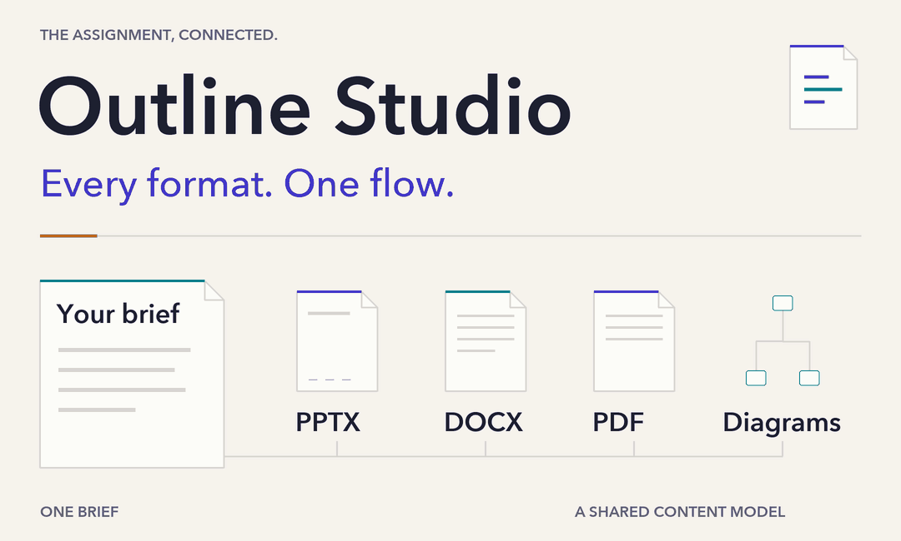
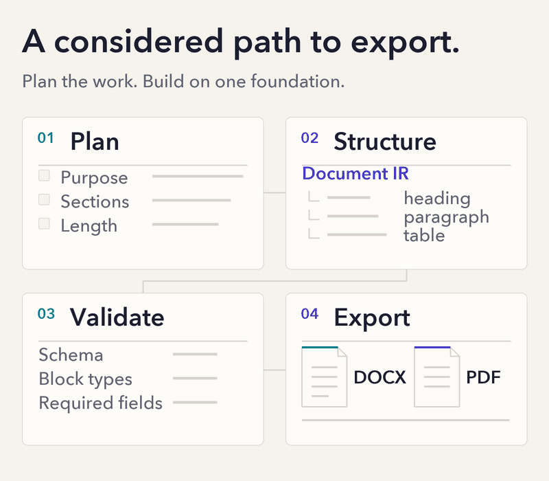
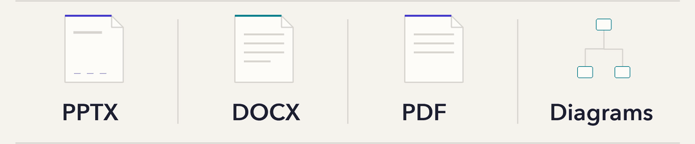

<p align="center">
  
</p>

<p align="center">
  <strong>Free, local-first AI assignment orchestrator.</strong><br>
  Turns a brief or rubric into PPTX, DOCX, PDF and diagrams. Bring your own API key.
</p>

<p align="center">
  <a href="#project-status">Status</a> · <a href="#the-workflow">Workflow</a> · <a href="#architecture">Architecture</a> · <a href="#development">Development</a> · <a href="#team">Team</a><br>
  <a href="docs/assets/banner-static.png">View static hero PNG</a>
</p>

## Project status

**Pre-implementation. No runnable application yet.** The repository contains documentation, artwork and the MIT license. There is no application source, package manifest or application test suite. The animations illustrate the intended product; they are not recordings of working software.

| Available now | Next to implement · Phase 1 | Later phases |
| :--- | :--- | :--- |
| Project documentation, reproducible artwork and license | Provider adapters, Zod Document IR, single agent chain, DOCX/PDF export and key vault | PPTX, diagrams, rubric extraction, review loops and more |

## One assignment, less rework

An assignment can require a report, slides and a diagram. Rebuilding the same ideas in separate tools makes revisions slow and inconsistencies easy to miss. Outline Studio is designed around one structured source that can feed several document renderers.

Start with a brief; shape the outline; review the content; choose the output. Rubric input and additional formats arrive after Phase 1.

## The workflow



[View static workflow PNG](docs/assets/workflow-static.png)

1. **Plan** — supply the topic, audience, length and requirements; shape an outline.
2. **Structure** — generate headings, paragraphs, tables and other typed content blocks.
3. **Validate** — check the document against its schema; review and revise the draft.
4. **Export** — render the same content into the required format, starting with DOCX/PDF.

Schema validation checks structure. It does not prove factual accuracy, citation quality or rubric compliance. Automated review and citation verification are later work.

## Formats



[View static format strip PNG](docs/assets/formats-static.png)

**DOCX and PDF:** Phase 1. **PPTX and diagrams:** Phase 2. No format exporter is implemented yet.

## Architecture

The planned browser application owns orchestration, local data and document rendering. A stateless Cloudflare Worker proxy forwards cloud generation requests to the selected provider.

```text
Brief → plan → provider adapter → structured content
                                      ↓
                               Zod Document IR
                                      ↓
                              review → renderers → files

Browser ⇄ Cloudflare Workers / Hono proxy ⇄ chosen provider
   └── Dexie / IndexedDB + optional WebCrypto key vault
```

**Zod Document IR** is the planned shared intermediate representation: typed JSON content validated at the model boundary and before export. The AI supplies content; browser renderers create the files. A common IR keeps format logic separate from generation and allows each renderer to be tested independently. The schema itself has not been implemented.

### Stack by responsibility

All technologies below are specified choices, not installed dependencies in this repository.

| Responsibility | Planned stack |
| :--- | :--- |
| Interface | React 19, TypeScript strict, Vite, Tailwind CSS v4, shadcn/ui |
| Orchestration and state | XState for the agent chain; Zustand for application state |
| Content contracts | Zod Document IR and boundary validation |
| Local persistence and key encryption | Dexie / IndexedDB; WebCrypto |
| Provider request proxy | Cloudflare Workers; Hono |
| Browser document rendering | docx, pdf-lib / pdfmake; PptxGenJS in Phase 2 |
| Diagram rendering | Mermaid; Graphviz WASM in Phase 2 |
| Background processing | Web Workers; Comlink |

## Development

There is no application installation or start command yet. This checkout has no `package.json`, lockfile, or dev/build/test scripts to run. Setup instructions will follow the Phase 1 workspace; the stack above is the implementation target.

To reproduce the documentation graphics, see [animation sources and commands](docs/animation/README.md). Those tools are separate from the future application's production dependencies.

## BYOK and provider configuration

Bring your own API key means choosing and paying for your own provider account. The planned settings flow is to select a supported provider and model, enter a key in the UI, and optionally save it in the encrypted vault. No provider adapter, model selector, proxy deployment or key vault exists yet, so there are no working provider configuration commands or environment variables to document.

Keys are intended to remain in session memory by default. Optional persistence will use a passphrase-derived WebCrypto key. Keys must never be committed, embedded in URLs, logged or stored as plaintext. **Free software does not guarantee free inference:** provider pricing, quotas and hosting limits still apply.

## Privacy boundaries

These are design requirements, not completed security guarantees.

- **Local-first storage:** history and document data are intended to live in browser IndexedDB. This does not keep cloud requests on-device.
- **Cloud generation:** selected content and API keys transit the proxy to the chosen provider. That provider's retention and processing policies apply.
- **Proxy boundary:** the proxy must restrict upstream hosts, limit requests and avoid retaining content or keys. These controls are not implemented yet.
- **Encryption at rest:** a locked vault protects stored key material. It does not protect an unlocked session from malicious JavaScript.

## Roadmap

| Phase | Scope | State |
| :---: | :--- | :--- |
| **01** | Provider adapters, Zod Document IR, single agent chain, DOCX/PDF export, key vault | **Next to build** |
| 02 | PPTX export, Mermaid/Graphviz diagrams, themes, streaming interface | Planned |
| 03 | Rubric extraction, review loop, citation verification, college templates | Planned |
| 04 | PWA offline support, OCR input, English/Hindi UI, accessibility pass | Planned |
| 05 | Local model integrations and renderer/template extensions | Planned |

## Team

| Member | Roll number |
|---|---|
| Krishnendu Adak | UG/SOET/30/24/343 |
| Krishnendu Das | UG/SOET/30/24/448 |
| Md Danish Raza | UG/SOET/30/24/369 |
| Sneha Das | UG/SOET/30/24/467 |
| Shreankita Das | UG/SOET/30/24/436 |
| Shruti Nayak | UG/SOET/30/24/423 |
| Rudra Bharti | UG/SOET/30/24/462 |
| Aniket Shaw | UG/SOET/30/24/409 |

## License

[MIT License](LICENSE). The existing copyright and license terms are unchanged.
